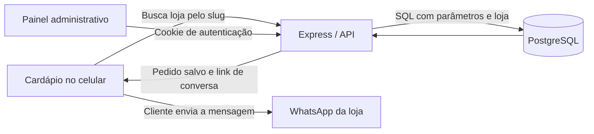

# Como a Menuza funciona

A aplicação tem um único servidor Node.js. Ele entrega os arquivos de tela e responde à API. O PostgreSQL guarda os dados. O navegador nunca se conecta diretamente ao banco.

## Onde fica cada parte

| Caminho                   | Responsabilidade                                        |
| ------------------------- | ------------------------------------------------------- |
| `frontend/cardapio`       | Cardápio, personalização, carrinho e finalização        |
| `frontend/admin`          | Login, gestão de pedidos e cadastros                    |
| `frontend/shared.js`      | Elementos de tela, requisições e formatação de dinheiro |
| `backend/src/config`      | Carregamento e validação da configuração                |
| `backend/src/routes`      | Endereços e autenticação do painel                      |
| `backend/src/controllers` | Ações administrativas e consultas                       |
| `backend/src/services`    | Cardápio e regras de cálculo/gravação do pedido         |
| `backend/src/middlewares` | Autenticação e validação das entradas                   |
| `backend/src/database`    | Conexão, migrations e seed                              |
| `backend/tests`           | Testes unitários, integração e navegador                |

## Uma base, várias lojas

O endereço `/doces-demo` informa qual loja o cliente quer consultar. A API resolve o slug para um `estabelecimento_id`. Esse identificador acompanha categorias, produtos, adicionais, clientes, pedidos, itens e histórico.

No painel, o identificador vem do usuário autenticado. Enviar outro `estabelecimento_id` no corpo da requisição não muda a loja do usuário. As consultas usam o identificador vindo do middleware de autenticação.

As chaves estrangeiras compostas são uma segunda proteção: um produto da loja A não pode apontar para uma categoria da loja B, nem um item de pedido para um pedido de outra loja. Elas comparam o par `(estabelecimento_id, id)`.

Duas buscas iniciais precisam identificar o contexto: estabelecimento pelo slug público e usuário pelo e-mail globalmente único no login. Depois disso, as consultas de negócio usam a loja resolvida. A tabela `estabelecimentos` usa seu próprio `id` como identificador do tenant; `migrations` é uma tabela técnica global.

## O caminho de um pedido

1. O cardápio busca `GET /api/:slug/cardapio`. A resposta tem dados da loja, categorias ativas, produtos ativos e adicionais aplicáveis.
2. O cliente escolhe quantidades e adicionais. O carrinho fica no `localStorage` com uma chave que inclui o slug. A tela estima o total usando os preços recebidos da API.
3. Ao confirmar, envia IDs, quantidades, dados necessários para atendimento e observações. Preços enviados por alguém que alterou o navegador são descartados pela validação.
4. O servidor inicia uma transação. É um bloco no qual todas as gravações dão certo juntas ou todas são desfeitas.
5. Ele trava a linha da loja com `FOR UPDATE`. Pedidos de lojas diferentes podem continuar ao mesmo tempo. Pedidos da mesma loja aguardam a sua vez para receber o próximo número.
6. Busca produtos ativos, verifica vínculo e limites dos adicionais, calcula preços em centavos e confere o valor para troco. Retirada tem taxa zero. Loja fechada não recebe pedido.
7. Salva cliente, pedido, itens, adicionais e o primeiro status. Copia nomes e preços nos itens: editar o produto amanhã não modifica o pedido de hoje. Nome e telefone do cliente também são copiados no pedido.
8. Incrementa o contador e confirma a transação. Se algo falhar, o contador e as gravações são desfeitos juntos.
9. Só então devolve número, total e link `wa.me`. A tela mostra confirmação e tenta abrir a conversa; oferece também um link para o caso de bloqueio de janelas.
10. O pedido já aparece no painel, mesmo que o cliente não envie a mensagem no WhatsApp. A loja confere e confirma o atendimento.

## Login e pedidos no painel

A senha é comparada com o hash bcrypt, nunca com texto puro guardado no banco. O JWT assinado fica em um cookie httpOnly: o JavaScript da tela não lê esse cookie. Cada requisição autenticada valida a assinatura e confirma que o usuário continua pertencendo àquela loja.

O painel busca pedidos e os separa por status com filtros. Cada mudança trava o pedido dentro de uma transação, valida a sequência e grava um evento no histórico. Não é possível ir de “Pendente” direto para “Concluído”.

## Segurança e dados pessoais

O backend valida entradas com Zod e limita tamanho de JSON, imagens e textos. Comandos SQL recebem valores separados do texto da consulta. As poucas partes variáveis do texto SQL (nomes de tabelas e campos do CRUD) vêm de listas fixas do servidor.

A interface cria elementos com `createElement` e preenche textos com `textContent`. Conteúdo de cliente ou loja não é inserido como HTML. O servidor aplica Helmet, política de conteúdo e rejeita origens externas. O login e a criação de pedidos têm limite de tentativas.

Coletamos nome, telefone e endereço quando há entrega. A informação fica nos pedidos para o atendimento e histórico. A loja deve estabelecer prazo de retenção apropriado e atender solicitações de privacidade. O operador pode anonimizar dados com uma rotina administrativa controlada; esta versão não tem uma tela de gestão LGPD. Não há coleta de número de cartão nem processamento de pagamento.

O botão aberto/fechado é manual. O campo de horários é um texto informativo, sem agenda automática. Valores do dashboard representam pedidos não cancelados, não uma conciliação financeira.
